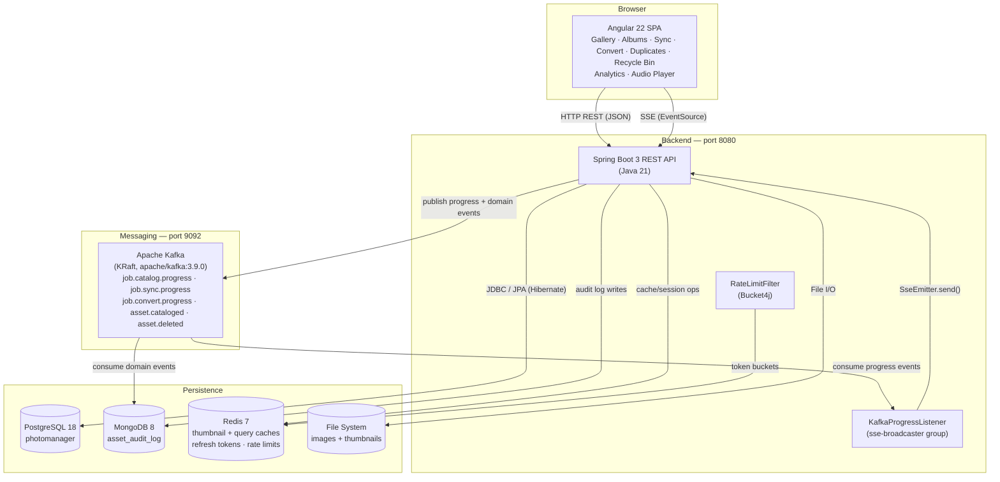
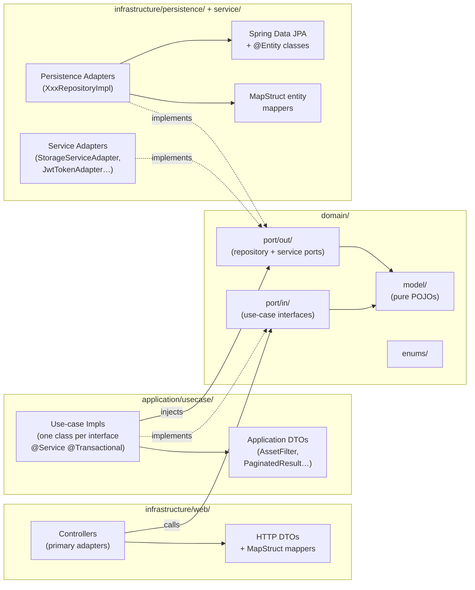
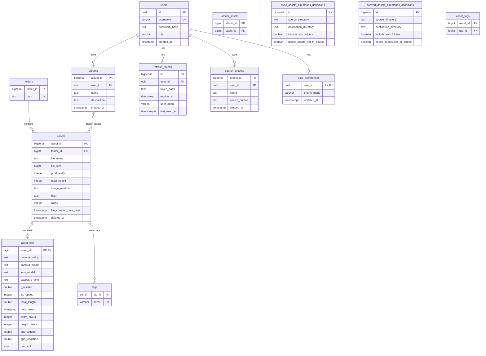
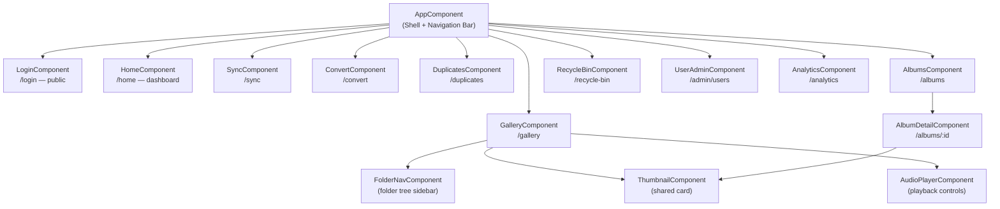

[← Back to README](../README.md)

# Architecture

## System Architecture



## Backend Hexagonal Architecture

The backend follows **Hexagonal (Ports and Adapters) Architecture** with strict, unidirectional layer dependencies enforced by package naming.



**Dependency flow:** `infrastructure/web → application/usecase → domain ← infrastructure/persistence | infrastructure/service`

The domain layer (`domain/model/`, `domain/port/in/`, `domain/port/out/`) has zero `jakarta.*`, `org.springframework.*`, or infrastructure imports.

Controllers in `infrastructure/web/controller/` delegate directly to use-case interfaces and never touch repositories or service adapters directly.

**Naming conventions:**
- Repository port interfaces: `XxxRepository` (in `domain/port/out/`) → `XxxRepositoryImpl` (in `infrastructure/persistence/adapter/`)
- Service port interfaces: `XxxPort` (in `domain/port/out/`) → `XxxServiceAdapter` (in `infrastructure/service/`)
- All entity↔domain and DTO↔domain conversions go through MapStruct-generated mappers; the `toEntityRef` pattern is used for FK-only references to avoid accidental updates to the referenced row

## Database Schema



The `asset_audit_log` collection (user-action history) lives in MongoDB, not PostgreSQL, so it isn't part of this diagram — see [Persistence](backend.md#persistence).

## Frontend Component Hierarchy

All routes are lazy-loaded via Angular's `loadComponent()`. Every route except `/login` is protected by `authGuard`, which redirects unauthenticated users to `/login`.



The default route (`/`) redirects to `/home`.

## Project Structure

```
JPPhotoManagerWeb/
├── backend/            # Java 21 + Spring Boot 3 Maven project
│   ├── Dockerfile      # Multi-stage build (Maven → JRE Alpine)
│   └── .dockerignore
├── frontend/           # Angular 22 npm project
│   ├── Dockerfile      # Multi-stage build (Node → Nginx Alpine)
│   ├── nginx.conf      # Serves SPA + reverse-proxies /api to backend
│   └── .dockerignore
├── grafana/provisioning/  # Grafana datasource + dashboard provisioning
├── prometheus.yml         # Prometheus scrape config
├── docker-compose.yml     # Orchestrates db, kafka, redis, mongo, backend,
│                          # frontend, prometheus, and grafana
├── .env.example           # Template for local Docker Compose configuration
├── k8s/                   # Kubernetes manifests (one StatefulSet/Deployment
│   │                      # + Service per docker-compose service)
│   ├── namespace.yaml
│   ├── configmap.yaml
│   ├── secret.yaml.example  # Template — copy to secret.yaml (git-ignored)
│   ├── catalog-volumes.yaml.example  # Template — copy to catalog-volumes.yaml
│   │                                 # (git-ignored); patched onto backend.yaml
│   ├── postgres.yaml         # `db`        → headless Service + StatefulSet
│   ├── kafka.yaml             # `kafka`     → headless Service + StatefulSet
│   ├── redis.yaml             # `redis`     → Service + Deployment
│   ├── mongo.yaml             # `mongo`     → headless Service + StatefulSet
│   ├── backend.yaml           # `backend`   → Service + Deployment + PVC
│   │                          # (no catalog hostPath — see catalog-volumes.yaml)
│   ├── frontend.yaml          # `frontend`  → Service + Deployment
│   ├── prometheus.yaml        # `prometheus`→ Service + Deployment
│   ├── grafana.yaml           # `grafana`   → Service + Deployment + PVC
│   └── ingress.yaml           # Routes external traffic to `frontend`
├── kustomization.yaml     # Entry point: `kubectl apply -k .`
└── scripts/               # Helper shell scripts (all cd to JPPhotoManagerWeb/ on their own)
    ├── build-and-deploy-k8s.sh # Builds images and applies the Kubernetes stack end-to-end
    ├── cleanup-k8s.sh          # Tears down the Kubernetes stack and locally built images
    ├── port-forward-k8s.sh     # Starts background port-forwards for Grafana/PostgreSQL/MongoDB/Kafka
    └── migrate-db.sh           # One-time migration of a host PostgreSQL catalog into Docker Compose
```

## Architecture review checks

What the `architecture-reviewer` skill checks in this project, on top of its generic dimensions (D1–D8). The items below are this project's own (P1–P16) and say which generic dimension each one extends: P1→D1, P2→D2, P3→D3, P4→D4 (browser storage), P5→D4 (state and coordination), P6→D8, P7→D5, P8→D7 (frontend); P9→D2, P10→D2, P11→D3, P12→D3, P13→D4, P14→D3, P15→D8, P16→D6 (backend).

### Dimensions

#### Frontend (`JPPhotoManagerWeb/frontend`)

P1. **File/folder organization & naming** — the `core → features ← shared`
   structure (`JPPhotoManagerWeb/docs/frontend.md`'s "Application structure"),
   whether feature folders stay self-contained, whether `shared/` holds
   genuinely multi-consumer code or single-consumer code kept there out of
   habit.
P2. **Layering & inter-layer communication** — the service pattern (data access
   in an injectable `core/services/` service wrapping the backend REST API,
   never a direct `HttpClient` call from a component), and how components talk
   to each other absent a direct parent/child relationship (an
   `@Input`/`@Output`, a shared service, or — see P5 — an implicit
   shared stream or signal).
P3. **API / data-access patterns** — `HttpClient` + `auth.interceptor.ts`
   (401 refresh-and-retry, error snackbar), the HttpOnly-cookie JWT model (no
   token handling in components), Server-Sent Events for catalog/sync/convert
   progress (subscription lifecycle: is every `EventSource`/SSE stream closed
   on destroy or completion?), and pagination (`PaginatedData` models and
   whether list endpoints are consumed page-wise rather than fetched whole).
P4. **Browser-storage (`localStorage`) usage** — enumerate every
   `localStorage` read/write under `JPPhotoManagerWeb/frontend/src/app/`
   (`Grep -rn "localStorage\." JPPhotoManagerWeb/frontend/src/app`, excluding
   `*.cy.ts`); confirm each is a genuine per-browser preference (theme, accent
   colour) rather than something that should be synced server-side, and
   confirm what the stored session value actually contains — an HttpOnly
   cookie model should not leave bearer tokens readable from JavaScript.
P5. **State management** — RxJS and/or signals in `core/services/`, no
   NgRx/Akita (appropriate for this app's actual complexity — don't recommend
   one unless evidence genuinely shows a need). The specific technique this
   skill applies here, always, on every run that touches this dimension: for
   every `core/services/` service that exposes a signal, a
   `BehaviorSubject`/`Subject`, an `effect()` dependency, or an event-like
   method (`refresh()`, `notify()`, a `version`/`tick`-style counter), `Grep`
   every consumer across the whole `frontend/src/app` tree and check whether
   those consumers span features unrelated to the service's own
   name/purpose. A service whose consumers span two or more features with no
   parent/child relationship to each other, and whose name doesn't describe a
   broadcast role, is the exact shape this skill exists to catch — flag it
   with the full consumer count and the list of features it spans. Start with
   services that already look cross-cutting (`background-sync.service.ts`,
   `media-player.service.ts`, `theme.service.ts`) but check every service.
P6. **Routing & guards** — lazy-loading coverage in `app.routes.ts`,
   functional guard usage (`authGuard`), whether route-level concerns (auth
   gating) stay out of feature components.
P7. **Error handling & logging** — `core/error-handler/global-error-handler.ts`
   and the interceptor's error snackbar coverage; whether a feature has grown
   its own ad hoc error handling instead of relying on the global pipeline.
P8. **Testing architecture** — a light pointer only (component-test ratio,
   whether new features get co-located `.cy.ts` files). Don't duplicate
   `cypress-unit-test-developer`/`e2e-suite`/`quality-metrics` — they own this
   in depth; flag it only if a structural pattern (e.g. a whole feature with no
   tests at all) shows up incidentally while reviewing another dimension.

#### Backend (`JPPhotoManagerWeb/backend`)

The backend follows hexagonal (ports and adapters) architecture:
`infrastructure/web → application/usecase → domain ← infrastructure/persistence | service`
(`JPPhotoManagerWeb/docs/architecture.md`, "Backend Hexagonal Architecture").
Base package: `JPPhotoManagerWeb/backend/src/main/java/com/jpablodrexler/photomanager/`
(abbreviated `<pkg>/` below). The rules for writing new code live in
`java-developer`, `kafka-events-conventions` and `redis-caching-conventions`;
this skill checks whether the codebase as a whole still obeys them.

P9. **Layer boundaries & the dependency rule** — verify, don't assume, with
   these greps (each hit is a finding unless it is a documented exception):
   - `domain/` importing `org.springframework`, `jakarta.`, or anything from
     `infrastructure/` (`Grep -rn "import org.springframework\|import jakarta\|import .*\.infrastructure\." <pkg>/domain`);
   - `application/usecase/` importing `infrastructure/` or Spring Data types
     (`...infrastructure\.` / `JpaRepository`);
   - controllers in `infrastructure/web/controller/` importing a repository
     port, `persistence/`, `@Entity` classes, or a service adapter instead of
     a `domain/port/in/` use-case interface;
   - a JPA `@Entity` or Mongo `@Document` returned from, or accepted by, a
     controller (domain/HTTP DTO boundary leaking);
   - `application/service/` and `config/` holding logic that belongs in a use
     case (a non-port "service" class in `application/` is a smell worth a
     look every time).
P10. **Port/adapter integrity** — every `domain/port/out/` port has exactly one
   adapter with the documented naming (`XxxRepository` →
   `XxxRepositoryImpl`, `XxxPort` → `XxxServiceAdapter`); every
   `domain/port/in/` interface has one use-case implementation; no adapter
   calling another adapter directly instead of going through a port; business
   rules living in adapters, controllers or MapStruct mappers rather than the
   domain/use case; ports so wide (a god-port with dozens of methods) that they
   have stopped being a boundary.
P11. **Transactions & consistency** — `@Transactional` placed on use-case
   implementations (not controllers, not persistence adapters, not
   `domain/`); self-invocation that silently bypasses the proxy; `@Async`,
   Kafka listeners and Spring Batch writers that mutate data with no
   transaction boundary of their own; read-then-write sequences across a
   Kafka hop that assume ordering or read-your-writes the system doesn't
   guarantee; multi-store writes (PostgreSQL + MongoDB + Redis + the file
   system) with no stated consistency story.
P12. **Persistence & data model** — which data lives where (PostgreSQL via JPA,
   MongoDB documents, Redis caches/stores, files on disk) and whether each
   choice is deliberate and documented rather than accreted; entities vs
   domain models vs documents kept separate through MapStruct; Flyway
   discipline in `src/main/resources/db/migration/` (strictly increasing
   `V<n>__` numbers with no gaps or duplicates, no edit of an already-applied
   migration, destructive changes called out, the directory `README.md`
   current); N+1 and unbounded-query risks at repository boundaries; indexes
   for the query shapes the use cases actually issue.
P13. **Messaging, async & coordination** — Kafka topics, consumer groups,
   `@Async`, Spring Batch jobs and SSE progress streaming
   (`infrastructure/kafka/`, `infrastructure/batch/`,
   `KafkaProgressRegistry`). **Always run the "hunt the broadcast" technique
   here**: for every topic (`config/KafkaTopicConfig.java`) grep every
   producer (`kafkaTemplate.send`) and every consumer (`@KafkaListener`), and
   for every listener that reacts to another feature's event (for example
   `AssetSearchCacheInvalidationListener`, `AuditLogKafkaListener`) list what
   it touches. Flag a topic or listener whose producers/consumers span two or
   more features with no direct relationship, a topic that is produced but
   never consumed (or the reverse), a use case that depends on a side effect
   in a listener it never calls, and an event whose consumers must run in a
   specific order. Report topic count, producer/consumer counts and the
   features spanned. Per-topic naming, consumer-group and retry rules belong
   to `kafka-events-conventions` — cite it rather than restating it.
P14. **Caching** — where cache logic lives (adapters, not use cases or
   controllers), whether every named cache has a documented invalidation
   story and TTL, whether a cache failure is fail-open, and whether two
   unrelated features share one cache or one key space. Per-cache rules
   belong to `redis-caching-conventions` — cite it.
P15. **API surface & security** — consistency across controllers (resource
   naming, status codes, error body shape via `infrastructure/web/exception`,
   pagination via the shared paginated models rather than ad hoc shapes);
   HTTP DTOs vs application DTOs vs domain models; `SecurityConfig` and
   `JwtAuthenticationFilter` — every endpoint's authorization intent explicit
   and per-user/admin scoping enforced in the use case or controller rather
   than assumed; the HttpOnly-cookie/refresh-token flow
   (`AuthCookieFactory`, `RefreshTokenIssuer`); SSE endpoints' lifecycle
   (emitter cleanup on completion, timeout and client disconnect).
P16. **Configuration, observability & testing architecture** — typed
   configuration properties vs scattered `@Value`; profile handling and
   secrets never committed (see the repo's secret-handling rules); health
   indicators, metrics and logging (`logback-spring.xml`, request IDs)
   covering the flows that actually fail; a light pointer on testing shape
   (unit vs integration balance, whether ports are what gets mocked). Don't
   duplicate `java-unit-test-developer`/`quality-metrics` — flag a structural
   gap (a whole use case or adapter with no tests) only if it shows up
   incidentally.

Docker Compose, the Kubernetes manifests and the Grafana/Prometheus setup are
out of scope; mention them only where a backend configuration coupling shows up.

### The shape the review hunts for

Assess whether the system's overall structure — not a specific diff or PR,
but the shape of the whole frontend and/or backend — still follows recommended
Angular and Spring practice and the project's own documented conventions. This
skill exists because the kind of issue it looks for rarely shows up in a
single-PR `code-reviewer` pass: it is implicit coupling that accretes
gradually, one individually-reasonable change at a time, across many separate
reviews that each only saw their own diff.

The motivating shape, on either side: a unit that starts as one narrow concern
(a preference, a playback state, a sync status, a cache-invalidation hook, one
Kafka topic) and quietly becomes the cross-feature "something changed, react"
channel for several unrelated features. Nothing about its name says so, and no
single PR that added one more consumer would have looked wrong in isolation.
The backend has its own classic drift on top of that: the hexagonal dependency
rule eroding one convenient import at a time.

[← Back to README](../README.md)
