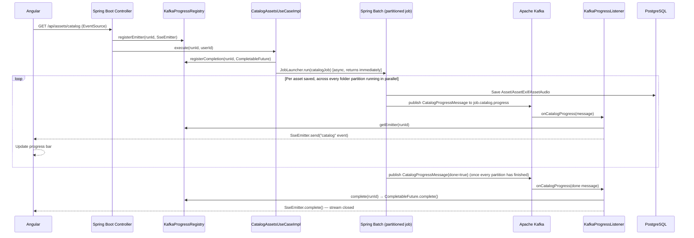

[← Back to README](../README.md)

# Frontend

## Technologies

| Technology | Version |
|---|---|
| Angular | 19 |
| Angular Material | 19 |
| Angular CDK | 19 |
| Angular Service Worker (PWA) | 19 |
| TypeScript | 5.6 |
| RxJS | 7.8 |
| ngx-charts | 24.0.0-alpha.1 |
| idb (IndexedDB wrapper, background sync) | 8.0.3 |
| Node.js (build/dev) | 22 |
| Cypress (component + e2e tests) | 15 |
| ESLint (`@angular-eslint`, `typescript-eslint`) | 9 |

## Application structure

```
src/app/
  app.component.ts/html/scss   → Shell with top navigation bar (shown only when logged in)
  app.routes.ts                → Lazy routes: /home, /gallery, /sync, /convert, /duplicates,
                                 /albums, /albums/:id, /recycle-bin, /admin/users, /analytics,
                                 /profile/sessions
  app.config.ts                → ApplicationConfig (HttpClient + interceptor, Router, Animations,
                                 global ErrorHandler)
  core/
    models/                    → TypeScript interfaces (Asset, Folder, PaginatedData, …)
    services/                  → Angular services wrapping the backend REST API
    guards/                    → auth.guard.ts — redirects unauthenticated users to /login
    interceptors/              → auth.interceptor.ts — handles 401 → refresh-and-retry or redirect
                                 to /login; also shows a MatSnackBar with the backend's error
                                 message (or a generic fallback) for terminal HTTP errors, appending
                                 "[Request ID: <id>]" when the response has an X-Request-ID header
    error-handler/             → global-error-handler.ts — Angular ErrorHandler override; shows a
                                 MatSnackBar with the error message for any unhandled component error
  features/
    auth/login/                → LoginComponent (/login)
    home/                      → HomeComponent (/home) — dashboard with stats
    gallery/                   → Thumbnail grid + full-size image viewer
    folder-nav/                → Folder tree (Angular CDK FlatTreeControl)
    sync/                      → Sync configuration and execution
    convert/                   → Convert configuration and execution
    duplicates/                → Duplicate detection and cleanup
    albums/                    → AlbumsComponent + AlbumDetailComponent
    recycle-bin/                → Restore/purge soft-deleted assets
    analytics/                  → Storage/format/rating charts (ngx-charts)
    audio-player/                → Playback controls for streamed audio assets
    admin/users/                → UserAdminComponent (/admin/users) — add/change password/delete users
    profile/sessions/           → SessionsComponent (/profile/sessions) — list active sessions with
                                 device hint and last-used time; revoke one or all-other sessions
  shared/
    components/thumbnail/      → Reusable thumbnail card component
    components/password-strength/ → Live password strength meter (colour bar + 4-rule checklist),
                                 evaluated client-side; used in UserAdminComponent's create-user and
                                 change-password forms
    pipes/file-size.pipe.ts    → Human-readable file size formatting
```

All components are **standalone** (no NgModules). Routes are lazy-loaded and, except `/login`, protected by `authGuard`:

| Path | Feature | Description |
|---|---|---|
| `/` | — | Redirects to `/home` |
| `/login` | Login | Public login form |
| `/home` | Home | Dashboard with catalog statistics |
| `/gallery` | Gallery | Paginated thumbnail grid and full-size viewer |
| `/sync` | Sync | Configure and run directory sync |
| `/convert` | Convert | Configure and run PNG→JPEG conversion |
| `/duplicates` | Duplicates | Find and remove duplicate images |
| `/albums` | Albums | List, create, rename, and delete albums |
| `/albums/:id` | Album detail | Paginated asset grid within an album |
| `/recycle-bin` | Recycle Bin | Restore or purge soft-deleted assets |
| `/admin/users` | User Administration | Add, change password, delete users |
| `/analytics` | Analytics | Storage, format, monthly, and rating charts |
| `/profile/sessions` | Sessions | View active sessions (device hint, last-used time), revoke one or sign out everywhere else |

## Gallery modes

- **Thumbnails mode** — paginated grid; each card displays a 200×150 thumbnail fetched from `/api/assets/{id}/thumbnail`.
- **Viewer mode** — full-screen; loads the original file from `/api/assets/{id}/image` with zoom controls. Double-click a thumbnail to enter viewer mode; click the grid icon to return.

## Real-time progress

Long-running operations (catalog, sync, convert) use the browser's native `EventSource` API to consume SSE streams from the backend, displaying live progress without polling.

**SSE (Server-Sent Events)** is a web standard where the server pushes a stream of text events to the client over a single long-lived HTTP connection. It is one-way (server → client only), HTTP-based — the client makes a regular `GET` request and the response stays open while the server writes `data: ...` lines as events occur — and browsers handle reconnection automatically if the connection drops.

**Kafka-mediated SSE pipeline:** progress events are not sent directly from the use case to the HTTP response. Instead, the catalog/sync/convert code publishes messages to a Kafka topic, and `KafkaProgressListener` looks up the registered `SseEmitter` for the run and forwards each message to the client. Unlike the audit-log/cache-invalidation consumers (which use a fixed, shared consumer group so exactly one backend instance processes each event), `KafkaProgressListener` relies on the default consumer group `spring.kafka.consumer.group-id: sse-broadcaster-${HOSTNAME}` — unique **per backend instance** — so that whichever replica is actually holding the client's SSE connection always gets its own copy of every progress message, regardless of which instance's `JobLauncher` is running the batch job. This decouples the long-running work from the HTTP layer and from any particular instance, and makes the pipeline observable by any downstream consumer.

For the catalog case specifically, the actual scanning/persisting happens inside a Spring Batch job with no `catalog_run_state`-style lock or heartbeat (see [Catalog Process](catalog-process.md#catalog-process) for the full picture — that custom table was dropped years ago in favor of Spring Batch's own job repository):



## Running the frontend

**Prerequisites:** Node.js 22, npm

```bash
cd JPPhotoManagerWeb/frontend

# Install dependencies
npm install

# Run development server (proxies /api to localhost:8080)
npm start
```

The app is available at `http://localhost:4200`. The dev server automatically proxies `/api` requests to the backend.

### Development proxy

All frontend services use **relative paths** (`/api/assets`, `/api/folders`, …) rather than hardcoded ports. During development, Angular's dev server forwards every `/api` request to the Spring Boot backend via `proxy.conf.json`:

```json
{
  "/api": {
    "target": "http://localhost:8080",
    "secure": false,
    "changeOrigin": true
  }
}
```

The browser only ever contacts port **4200** (the `ng serve` dev server's default port); the proxy rewrites and forwards the request to port **8080** on the server side. Port 4200 is a local-development-only detail — the Docker Compose setup exposes the app on port **80** via nginx instead. This means:

- No CORS headers are needed in development — both the HTML page and the API responses come from the same origin (`localhost:4200`).
- Image `` tags, `EventSource` SSE connections, and `HttpClient` calls all work automatically because the browser always uses the same origin.
- Changing the backend port only requires updating `proxy.conf.json` — no source code change.

In production the Angular build produces a static bundle that is served by **nginx** (`nginx.conf`), which applies the identical routing rule:

```nginx
location /api/ {
    proxy_pass http://backend:8080/api/;
}
```

## Building for production

```bash
cd JPPhotoManagerWeb/frontend
npm run build:prod
```

Output goes to `dist/jp-photo-manager-ui/`.

## Running frontend tests

Tests are **Cypress Component Testing** (`*.cy.ts` files colocated with the code under test) plus two separate Cypress E2E tiers (below) — there is no Karma/Jasmine setup.

```bash
cd JPPhotoManagerWeb/frontend

# Component tests, headless (what CI runs)
npm test

# Component tests with code coverage
npm run test:coverage

# Interactive Cypress runner (component mode)
npm run cypress:open

# Lint
npm run lint
```

Full conventions and worked examples, including the code coverage setup:
the `cypress-unit-test-developer` skill
(`.claude/skills/cypress-unit-test-developer/SKILL.md`).

## Running E2E tests

There are **two** distinct Cypress E2E tiers, in `cypress/e2e/` — don't
confuse them, they need very different prerequisites.

### The mocked E2E smoke tier (CI-safe, no backend needed)

Lives at `cypress/e2e/mocked/` with its own config
(`cypress.mocked.config.ts`, not `cypress.config.ts`'s own `e2e` block —
that block `excludeSpecPattern`s this directory, so a plain `npm run
test:e2e` never runs it, and vice versa). No real login, no running
backend, no Docker: `cypress/support/mocked/seed-session.ts` writes a
fabricated session directly into `localStorage` before the app bootstraps,
and every `/api/**` call is stubbed via `cy.intercept`.

```bash
cd JPPhotoManagerWeb/frontend
npm run test:e2e:mocked
```

This starts `ng serve` itself (`start-server-and-test`) and is the E2E tier
`.github/workflows/web-test.yml` actually runs, on every push/PR. Scope is
golden-path smoke only — one auth-guard check, one render assertion, and
one representative CRUD interaction per major route.

### The maintained real-backend E2E suite (manual, full stack required)

Lives at `cypress/e2e/` (everything *except* `mocked/`) — a real
Chrome/Electron instance driving a real login against a real, locally
running backend (Postgres, MongoDB, Redis, Kafka). Nothing is mocked. It is
**not** wired into CI — bringing up that much infrastructure on every push
isn't worth it; run it manually before a release or after a change
spanning multiple features. Full conventions, the test-data/cleanup
pattern, and how to add a new spec: the `e2e-suite` skill
(`.claude/skills/e2e-suite/SKILL.md`).

```bash
cd JPPhotoManagerWeb/frontend
npm run test:e2e
```

Unlike the mocked tier's command, this does **not** start the dev server
itself — `ng serve` (`npm start`) and the backend must already be running.
See "Running the whole E2E test suite" below for the full startup sequence.

Logs in as the seeded `admin`/`admin` account (`DataInitializer`) — fixed,
not a secret file, since there's no email-confirmation constraint to work
around. Every spec captures the id of whatever it creates (album, secondary
user) and deletes it explicitly, either through the real UI as part of what
it's testing or via a direct `cy.request` `DELETE` as an `after()` safety
net — there's no bulk "delete everything" endpoint to sweep with.

**Login rate limiting**: the backend's own `RateLimitFilter` caps `POST
/api/auth/login` at 10 requests per 60 seconds per IP (a real anti-brute-
force control, not a bug). Running every spec file back to back in one
`npm run test:e2e` can consume all 10 within the run — if you see `POST 429
/api/auth/login` on a spec that ran shortly after others, that's why. See
the `e2e-suite` skill for the batching workaround; don't raise the backend
limit to work around this.

### Running the whole E2E test suite

The real-backend suite (unlike the mocked tier) needs its prerequisites
started by hand, in order:

```bash
# 1. Infra: Postgres, Kafka, Redis, MongoDB (from JPPhotoManagerWeb/)
docker compose up -d db kafka redis mongo
# Note: compose maps Postgres to host port 5433, not 5432

# 2. Backend (from JPPhotoManagerWeb/backend/) — needs JWT_SECRET and,
#    since infra came from compose, POSTGRES_PORT=5433
JWT_SECRET=$(openssl rand -base64 32) POSTGRES_PORT=5433 mvn spring-boot:run

# 3. Frontend (from JPPhotoManagerWeb/frontend/)
npm start

# 4. Component tests
npm test

# 5. Mocked E2E smoke tier
npm run test:e2e:mocked

# 6. Real-backend E2E suite (see the rate-limit note above if this fails
#    with a 429 partway through)
npm run test:e2e
```

`application-local.yml` (gitignored, `application-local.yml.example` is
the template) can set `JWT_SECRET` there instead of passing it as an env
var each time. Full backend startup detail, including the individual
`docker run` fallback commands if you'd rather not use Compose: the
`e2e-testing` skill §1–§2, and `docs/backend.md` ("Running the backend").

---

---

## Installing as a Progressive Web App (PWA)

JP Photo Manager ships as a PWA: it can be installed as a standalone desktop or mobile app directly from the browser, with offline thumbnail caching and background sync for rating changes.

> **Important:** The PWA service worker only activates in a **production build**. Install prompts will not appear when running the Angular dev server (`npm start`). Use the Docker Compose setup or a production build served by nginx.

### Prerequisites

The app must be running via Docker Compose (see [Running with Docker Compose](docker-compose.md#running-with-docker-compose)):

```bash
cd JPPhotoManagerWeb
cp .env.example .env
# Edit .env: set HOST_IMAGE_DIR and JWT_SECRET at minimum
docker compose up --build
```

Then open `http://localhost` in a supported browser.

### Installing from the browser

| Browser | How to install |
|---|---|
| **Chrome / Edge** | An install icon (⊕) appears in the address bar — click it, then **Install** |
| **Chrome (menu)** | ⋮ menu → **Save and share** → **Install JP Photo Manager** |
| **Edge (menu)** | ··· menu → **Apps** → **Install this site as an app** |
| **Safari (macOS)** | **File** → **Add to Dock** (requires macOS Sonoma or later) |
| **Safari (iOS)** | Share sheet → **Add to Home Screen** |
| **Firefox** | Not supported — Firefox does not implement PWA installation |

Once installed the app opens in its own window (no browser chrome) under the name **JP Photo Manager** (short name: **PhotoMgr**).

### PWA capabilities

| Capability | Detail |
|---|---|
| **Offline thumbnail cache** | Previously viewed thumbnails are served from the service-worker cache when the network is unavailable (cache-first strategy configured in `ngsw-config.json`) |
| **Background sync for ratings** | Star-rating changes made while offline are queued in IndexedDB via `BackgroundSyncService` and replayed automatically when connectivity is restored; a snackbar notification confirms the replay |
| **App icons** | Full icon set from 72×72 to 512×512 pixels, suitable for home screens and taskbars |


## Code review checks

What the `code-reviewer` skill checks in this project, on top of its generic frame. This doc holds the frontend subsections; the backend ones and the ones that apply to both sides (§14, §15 and the shared parts of §18, §19, §21 and §24) are in `docs/backend.md`, as is the sweep layer table. The section numbers (§N) are the ones the review reports cite, so they stay stable: each lives in exactly one of `docs/backend.md` and `docs/frontend.md`.

### 1. Architecture & Layering (both sub-projects)

The intro and the shared subsections of this section are in `docs/backend.md`'s `Code review checks`; the subsections below are this side's.

#### 1.3 Frontend layer rules

```
core/       → services and models only; no UI components
features/   → page-level smart components; calls core services and shared components
shared/     → pure presentational components and pipes; no service calls
```

🔴 Flag any component in `shared/` that injects or calls a service directly.

🟡 Flag any service placed under `features/` — it belongs in `core/services/`.

### 10. Frontend: Angular Conventions

#### 10.1 Component structure

🔴 Flag any `NgModule` — all components must be `standalone: true`.

🔴 Flag `*ngIf` or `*ngFor` in templates — use `@if` / `@for` (Angular 17+
control flow) instead.

🟡 Flag `@for` without a `track` expression.

🟡 Flag a component's `imports: []` that includes a module the template
doesn't actually use.

🟡 Flag a component that subscribes to observables in the constructor instead
of `ngOnInit`.

🔴 Flag a component that opens an `EventSource` but doesn't close it in
`ngOnDestroy`.

#### 10.2 Services

🔴 Flag a service that subscribes to an `Observable` internally — services
must return `Observable<T>` and let the component subscribe.

🟡 Flag a service without `providedIn: 'root'`.

🟡 Flag HTTP logic inside a component — API calls belong in `core/services/`.

🟡 Flag a service file that contributes no logic of its own and just
re-exports or aliases another service (e.g.
`export { FooService as BarService } from './foo.service';`, or a class whose
every method is a one-line passthrough to an injected service of a different
name for the same capability). Same test as the backend port/adapter case in
§1.2: the question is whether it adds logic, not whether something imports
it. Delete it and repoint any importers to the real service — see the
`AudioPlayerService` entry in §15.

#### 10.3 Routing

🟡 Flag a new feature route that is not lazy-loaded with `loadComponent`.

🟡 Flag a direct import of a feature component in `app.routes.ts` instead of
a dynamic import.

#### 10.4 Material Component Layout Gotchas

🟡 Flag a `mat-icon` placed inside `mat-card-avatar` with no matching CSS
rule sizing and centering it (`width`/`height`, `font-size`/`line-height`,
flex-centered). `mat-card-avatar`'s built-in sizing (`object-fit: cover`,
`overflow: hidden`) is designed for an `` — left unstyled for a
`mat-icon`, the glyph renders oversized and gets clipped by the avatar
circle down to an unrecognizable fragment.

🟢 Flag a `mat-form-field` placed as the very first element in
`mat-card-content`, directly under a `mat-card-title` with nothing else
between them, that has no `margin-top` of its own. The field's
floating-label notch plus `mat-card-header`'s tight bottom padding tends to
read as the field crowding the title above it.

🟡 Flag the app shell's root `mat-toolbar` if it stays pinned on screen by
neither of this app's two valid mechanisms: an explicit `position: fixed`/
`sticky` rule with a matching sibling offset (e.g. a `margin-top` equal to
the toolbar's height, so taking it out of flow doesn't overlap the content
below it), *or* — the mechanism `app.component.scss` actually uses — being
a normal-flow flex-column sibling of a `flex: 1; min-height: 0;`,
independently-`overflow-y: auto` content container, so only that container
scrolls and the toolbar (never taken out of flow at all) never moves.
`<mat-toolbar>` has no built-in pinning of its own — a toolbar with
neither mechanism applied sits in normal document flow and scrolls out of
the viewport with page content.

🟢 Flag a **new** app-shell, dialog, or full-page layout that scrolls the
whole document under a `position: fixed`/`sticky` header instead of
confining scroll to a `flex: 1; min-height: 0; overflow-y: auto` content
container the way `app.component.scss` already does — a document-level
scrollbar then spans the full viewport height and runs past the header's
own boundary. Prefer a `height: 100vh`/`100dvh` flex column with the
header as a normal-flow sibling above the scrolling content region; only
reach for `position: sticky`/`fixed` plus a compensating offset if
document-level scroll is genuinely intended elsewhere on the same page.
This applies to newly-introduced scroll regions and shell restructures —
the app's existing shell already follows the correct pattern, so don't
re-flag it on an unrelated change.

🟡 Flag a row-like flex container (a list row, a card's action bar, any
element packing an icon/name/secondary-text/count/buttons on one line)
whose CSS gives it `display: flex` with no `flex-wrap` and no
narrow-viewport fallback (a media query, a container query, or a
restructure into a two-line layout below a breakpoint). At full width
this looks fine; at a real phone width the flex children fight over too
little space, and a shrinking text child can visually overlap a
fixed-width sibling instead of the row wrapping cleanly. Confirm the
change was actually checked at `angular-developer` §20's standard mobile
check device, not just eyeballed at desktop width or a wider handset
preset.

🟢 Flag a `flex-wrap: wrap` action-button row (a toolbar of several
buttons) with no shared width rule on its buttons. Wrapping alone stops
the horizontal-scroll problem, but each button still sizes to its own
icon+label content by default — once a narrow viewport forces one button
per line, a short label ends up visibly narrower than a long one, reading
as a ragged, unpolished column. The buttons should share a uniform width
once wrapped — stacking each full-width is the simplest correct fix.

🟡 Flag an outline `mat-form-field` whose floating `mat-label` can be
**clipped or truncated**:
- Placed as the first element inside a scrollable container (`mat-dialog-
  content`, or any `overflow: auto`/`hidden` region) with no `margin-top`
  on the field or its row — the label sits a few pixels above the field's
  border box, and the container clips it at its padding box once the
  content scrolls. This is the scroll-clipping counterpart of the
  `mat-card-content` crowding flag above.
- Hard-sized narrower than its label needs (`width`/`flex: 0 0 <fixed>`
  under a longer `mat-label`) — the label renders with an ellipsis. A
  labelled field should use `min-width` plus a growable `flex`, size to
  content, or carry a shorter label instead.

🟡 Flag a `mat-form-field` that is meant to fill its row or card but has
no width rule of its own (`width: 100%`, or a growable `flex: 1` with
`min-width: 0`). Material form fields size to their default intrinsic
width, so a field inside a flex row or a wrapper that also holds a hint can
render far narrower than its container; a width cap placed on a wrapper
that holds both the field and its hint caps the hint too. Check the
reused-form-class case as well — a width class written for one form that
silently applies to a second.

🟡 Flag a `mat-form-field` bound to a `FormControl` with validators —
typically a catalog/dialog **add row** or an otherwise-optional field —
that surfaces its error state on a bare focus-then-blur, before the user
has attempted the submit/add. Angular Material's default
`ErrorStateMatcher` fires on `invalid && touched`, Material marks a
control `touched` on blur, and `MatDialog` auto-focuses the first field on
open — so any later click trips a "required" error the user never
provoked. Look for a template `<mat-error>` gated on `control.touched`
(rather than an explicit "attempted" signal), and for a validated add-row
field with **no** custom `[errorStateMatcher]` (the `<mat-error>` `@if`
alone doesn't keep the field's own red outline/label out of the error
state). The fix pattern: an `xAttempted` signal set only on an invalid
submit, reset after success, gating both the `@if` and a per-field
matcher.

### 11. Frontend: TypeScript Conventions

🔴 Flag any use of `any` — use a typed interface, `unknown` with a type
guard, or `Partial<T>`.

🔴 Flag `console.log` / `console.error` left in committed code — use
`MatSnackBar` for user-facing feedback and remove debug output.

🟡 Flag `!` (non-null assertion) that could be replaced with optional
chaining (`?.`) or a null check.

🟡 Flag a property initialised as `undefined` that could be typed as optional
(`field?: Type`).

🟡 Flag an interface defined inline in a component — move it to
`core/models/`.

---

### 12. Frontend: Naming Conventions

| Element            | Expected                   | Example                                    |
| ------------------ | -------------------------- | ------------------------------------------ |
| File               | `kebab-case.<type>.ts`     | `asset.service.ts`, `gallery.component.ts` |
| Class              | PascalCase                 | `GalleryComponent`, `AssetService`         |
| Interface          | PascalCase                 | `Asset`, `PaginatedData`                   |
| String union       | UPPER_SNAKE_CASE           | `'FILE_NAME' \| 'FILE_SIZE'`               |
| Property / method  | camelCase                  | `currentFolder`, `loadAssets()`            |
| Component selector | `app-kebab-case`           | `app-gallery`                              |
| Test suite         | `describe('ClassName')`    | `describe('GalleryComponent')`             |
| Test case          | `it('should <behaviour>')` | `it('should display thumbnails')`          |

🟡 Flag any violation of the above.

---

### 13. Frontend: Cypress Tests

🔴 Flag Cypress tests that use Jasmine matchers (`toBe`, `toEqual`) — use
Chai assertions (`expect(...).to.equal(...)`, `cy.get(...).should(...)`).

🔴 Flag component tests missing `provideNoopAnimations()` — Angular Material
animations cause flaky failures in Cypress.

🟡 Flag service stubs typed as `any` — use `Partial<ServiceType>`.

🟡 Flag `EventSource` usage in a test without `MockEventSource` — real SSE
connections must not be opened in component tests.

🟡 Flag test files placed outside the source tree (e.g., in a top-level
`tests/` folder) — test files must be co-located with their source files as
`*.cy.ts`.

🟡 Flag a test that mutates a component's plain (non-signal) field directly
(e.g. calling a component method from test code that sets a field, then
asserting on the resulting DOM state) via only `fixture.detectChanges()`
— in this zoneless app that needs an explicit
`fixture.componentRef.injector.get(ChangeDetectorRef).markForCheck()`
first, or the view is never rechecked.

🟡 Flag `import { mount } from 'cypress/angular'` in a test file — `cy.mount`
is a global command already registered in `cypress/support/component.ts`;
a test file should never import `mount` directly.

🟡 Flag a `describe` block with no `beforeEach` that repeats the same
`cy.mount()` call in every `it` — extract to `beforeEach`.

🟡 Flag a CSS/template fix, or a new multi-field/multi-button UI, with no
layout regression test in the component's `.cy.ts` — a `cy.viewport(384, 824)`
**and** a desktop-width `cy.viewport(...)` assertion on measured geometry
(`getBoundingClientRect`: no overlap, fields filling their container, buttons
sharing a width once wrapped). A layout test that only checks the element
exists passes while the real layout is broken. Say the layout is
**unverified** rather than approving it when the PR or report doesn't state
it was checked at both widths.

### 18. Cyclomatic Complexity (both sub-projects)

The intro and the shared subsections of this section are in `docs/backend.md`'s `Code review checks`; the subsections below are this side's.

#### 18.1 Frontend (TypeScript)

Run from `frontend/`:

```
npm run complexity
```

(equivalent to `node scripts/cyclomatic-complexity.js src/app`, which walks
every non-`.cy.ts` `.ts` file under a given directory via the TypeScript
compiler API — see `frontend/scripts/cyclomatic-complexity.js`, same
decision-point rules as ESLint's built-in `complexity` rule). It exits
non-zero and lists every offending function (file, line, name, complexity)
when anything exceeds the threshold. For a scoped review, either run it
against the whole tree and filter the output to the changed files, or pass a
narrower directory directly, e.g.
`node scripts/cyclomatic-complexity.js src/app/features/gallery`.

### 19. Code Coverage (both sub-projects)

The intro and the shared subsections of this section are in `docs/backend.md`'s `Code review checks`; the subsections below are this side's.

#### 19.1 Frontend (TypeScript)

Run from `frontend/` (collect coverage, then check the threshold):

```
npm run test:coverage
npm run coverage:check
```

`test:coverage` (`cypress run --component --env coverage=true`) re-runs the
component suite with `babel-plugin-istanbul` instrumentation active and
writes `html`/`lcov`/text-summary reports to `coverage/` (gitignored).
`coverage:check` (`nyc check-coverage`) reads the `lines`/`branches`/
`functions`/`statements` thresholds (80 each) from `.nycrc.json` and fails
(non-zero exit) if any falls short.

For a **scoped review** (a single component, service, or feature directory
rather than the whole frontend), don't rely on the whole-project number —
narrow the check with `--include`, which filters the already-collected
coverage map down to matching paths before the threshold is evaluated:

```
npx nyc check-coverage --include "src/app/features/albums/**" --lines 80 --branches 80 --functions 80 --statements 80
```

(`test:coverage` still needs to have run first — `--include` only filters
which already-collected files count toward the ratio, it doesn't limit
which specs execute.)

### 20. Type Coverage (frontend)

Every reviewed frontend scope also gets a type-coverage pass — how much of
the TypeScript identifier surface has a real, non-`any` type, as opposed
to `any` reached via an explicit annotation, an untyped third-party return
value, or TypeScript inference giving up. This is the quantitative
backstop for §11's "no `any` unless unavoidable" convention: that rule
catches an `any` a reviewer happens to read past, this catches one that
slipped through review entirely.

Run from `frontend/`:

```
npx type-coverage --project tsconfig.app.json --detail
```

(or `npm run type-coverage:report` for a dated snapshot under
`docs/reports/type-coverage/`, listing every uncovered identifier grouped
by file — better for a full-codebase sweep than a scoped review).

🟡 Flag any identifier the tool reports as untyped that isn't already
caught by §11's manual `any` check. Same severity as that rule, not a
separate threshold-based gate — a single untyped identifier is exactly as
fixable regardless of the project-wide percentage.

🟢 Don't chase the last fraction of a percent in files that are
overwhelmingly typed already — note the project-wide percentage but only
flag specific uncovered identifiers actually touched by the reviewed
change (or, for a full sweep, the files with the most per the report's
file-grouped table).

---

### 21. Dead Code

The intro and the shared subsections of this section are in `docs/backend.md`'s `Code review checks`; the subsections below are this side's.

#### 21.1 Frontend (knip)

Run from `frontend/`:

```
npx knip
```

(or `npm run dead-code:report` for a dated snapshot under
`docs/reports/dead-code/`, split into unused files/exports/types/
dependencies/unlisted-dependencies). Configured in `frontend/knip.jsonc` —
see that file's comments for why Cypress config/spec files and a handful
of name-resolved devDependencies (`@angular-devkit/build-angular`,
`babel-plugin-istanbul`) need explicit entries/ignores before the tool's
findings are trustworthy on this Angular + Cypress project.

### 22. Performance & Accessibility (Lighthouse, frontend)

Scoped narrowly today: `npm run lighthouse:report` (self-builds the
production bundle and audits it — see
`frontend/scripts/lighthouse-report.mjs`) only covers `/login`, the one
route reachable without an authenticated session (every other route is
behind `authGuard`, and there is no self-registration flow to also cover —
accounts are admin-created via `/admin/users`). There is no equivalent to
the mocked E2E tier's session-fabrication trick for Lighthouse, so this
does not run against any authenticated route yet.

Run from `frontend/`:

```
npm run lighthouse:report
```

Writes a dated snapshot to `docs/reports/lighthouse/` — Performance,
Accessibility, Best Practices, and SEO scores (0–100), plus every failed
accessibility audit by name.

🟡 Flag any accessibility audit failure on a route touched by the reviewed
change — Angular Material does not guarantee WCAG compliance for free,
and this is the only automated a11y signal this project has.

🟢 A performance/SEO score regression is worth a passing mention (note the
before/after numbers if both are available) but isn't a hard gate the way
§18/§19's thresholds are — there is no established baseline yet for either
score.

---

### 23. Deep Accessibility Audit (cypress-axe, frontend)

§22's Lighthouse accessibility score only ever covers `/login` — the one
route reachable without an authenticated session — and even there it's a
single aggregate number, not the actual rule that failed. `npm run
a11y:report` (`frontend/scripts/a11y-report.js`) is the deep, per-route
complement: it drives `cypress-axe` (axe-core through Cypress) against every
authenticated route (`/home`, `/gallery`, `/sync`, `/convert`, `/duplicates`,
`/admin/users`, `/albums`, `/albums/:id`, `/recycle-bin`, `/analytics`,
`/profile/sessions`) using the same session-fabrication trick as the mocked
E2E smoke tier (`visitWithSession()` from
`cypress/support/mocked/seed-session.ts`, `cy.intercept`-stubbed `/api/**`
calls — no live backend needed).

Run from `frontend/` (needs the dev server reachable at
`http://localhost:4200` first, e.g. `npm start` in another terminal):

```
npm run a11y:report
```

The underlying spec (`cypress/e2e/a11y/a11y-audit.cy.ts`, driven by its own
`cypress.a11y.config.ts`) lives outside both existing Cypress tiers —
excluded from `cypress.config.ts`'s `e2e.excludeSpecPattern` and never
matched by `cypress.mocked.config.ts`'s narrower `specPattern` — so it never
runs as part of `npm run test:e2e` or `npm run test:e2e:mocked`. It calls
`cy.checkA11y(..., skipFailures: true)`, so a real violation is recorded as a
finding, not a failed test; the report script also tolerates a non-zero
Cypress exit code rather than crashing.

Writes a dated snapshot to `docs/reports/a11y/` — total violations by
impact level (critical/serious/moderate/minor), then a per-route breakdown
of every violated WCAG rule (rule id, impact, affected selector(s), help
URL).

🔴 Flag any `critical` or `serious` impact violation on a route touched by
the reviewed change.

🟡 Flag any `moderate` impact violation on a route touched by the reviewed
change.

🟢 A `minor` impact violation, or any violation on a route the change didn't
touch, is worth a passing mention but isn't required to be flagged.

### 24. Mutation Testing (both sub-projects)

The intro and the shared subsections of this section are in `docs/backend.md`'s `Code review checks`; the subsections below are this side's.

#### 24.1 Frontend (StrykerJS)

Run from `frontend/`:

```
npm run mutation:report
```

(`scripts/mutation-report.js`, driven by `stryker.conf.mjs`). Cypress
Component Testing has no native Stryker test-runner plugin (only
Jest/Mocha/Karma/Jasmine/Vitest are supported that way), so this uses
StrykerJS's generic **command** runner — and the config carries two
non-obvious things worth knowing before touching it:

- **The browser/`process` bridge.** The command runner's mutant-switch
  instrumentation reads `process.env.__STRYKER_ACTIVE_MUTANT__` to decide
  which mutant is "active," but the code under test runs inside a Cypress
  *browser* iframe, which has no Node `process` global. Without a bridge,
  every mutant silently "survives" — the switch never activates, the
  original code always runs, and the mutation score is permanently stuck
  at 0% regardless of test quality (confirmed empirically while building
  this: an identical mutation applied by hand and run directly correctly
  failed its test, while the same mutation via `npx stryker run` did not).
  The fix lives in `cypress.config.ts`'s component `setupNodeEvents`
  (forwards the env var into `config.env`) and
  `cypress/support/component.ts` (reads it via `Cypress.env(...)` and
  assigns `globalThis.process` before any spec file's own imports
  evaluate — ES module evaluation order guarantees the support file's
  top-level code runs first). If a mutation score is ever suspiciously and
  uniformly ~0% again, check that bridge before assuming the tests
  themselves are weak.
- **Narrow, curated scope.** `stryker.conf.mjs`'s `mutate` list is a
  hand-picked ~8 files under `core/` with genuine branching logic
  (services/interceptors with real conditionals — not thin HTTP CRUD
  wrappers), and `commandRunner.command` runs a scoped
  `cypress run --component --spec` (`npm run test:mutation`) covering only
  those files' own specs, not the full ~650-test suite. The command runner
  reruns the whole configured command per mutant — Stryker's live
  "remaining time" estimate is unreliable in the first few percent (it
  initially extrapolates from the slow first mutant, which pays a
  one-time Electron/npx warm-up cost the rest don't), so don't judge
  whether a run is worth letting finish from an early ETA: the full
  8-file scope (553 mutants) completed in under 14 minutes end to end at
  `concurrency: 1`, despite briefly showing an in-run estimate north of 8
  hours. When reviewing a scope this narrow, treat the resulting score as
  a sample of core/'s branchiest logic, not a whole-frontend figure —
  extend `mutate` to a changed file directly (temporarily, for a scoped
  review) rather than trusting the existing list to already cover it.

Writes a dated snapshot to `docs/reports/mutation/` — overall mutation
score, killed/survived/timeout/no-coverage counts, a per-file table sorted
worst-first, and a full list of surviving/uncovered mutants (file, line,
mutator, replacement).

### 25. Secrets Scanning, License Compliance, and Dependency Vulnerabilities (frontend)

Three more report-only metrics, all frontend-scoped tooling but scanning
beyond `frontend/` where relevant:

**Secrets scanning** — `npm run secrets:report`
(`frontend/scripts/secrets-scan-report.js`) scans the whole repository —
backend Java source, k8s manifests, docs, everything — not just
`frontend/` — with [secretlint](https://github.com/secretlint/secretlint)
for accidentally committed API keys, private keys, tokens, and other
high-confidence secret patterns. Uses secretlint's `unix` output formatter
deliberately, not `json` — the json formatter dumps every scanned file's
full unmasked content alongside any findings, both slow and a real
exposure risk if that output is ever mishandled. Every credential-shaped
file in this repo (`JPPhotoManagerWeb/.env`, `JPPhotoManagerWeb/k8s/secret.yaml`,
`JPPhotoManagerWeb/k8s/catalog-volumes.yaml`) is excluded via
`.secretlintignore` at the repo root, on top of secretlint's own
`.gitignore` respect. Writes a dated snapshot to
`docs/reports/secrets-scan/` — file, line, rule, and message per finding.

**License compliance** — `npm run license:report`
(`frontend/scripts/license-compliance-report.js`, via
[license-checker-rseidelsohn](https://github.com/RSeidelsohn/license-checker-rseidelsohn))
checks every resolved npm dependency's declared license, flagging the
copyleft family (GPL/AGPL/LGPL/SSPL/EUPL/CC-BY-SA/OSL/CPAL) and anything
unresolvable — this repo is public, so an unnoticed copyleft dependency is
a real concern. The backend equivalent is `bash backend/scripts/license-report.sh`
(license-maven-plugin's `add-third-party` goal, invoked ad hoc via its full
plugin coordinate — no `pom.xml` changes needed). Writes a dated snapshot
to `docs/reports/license-compliance/`.

**Dependency vulnerabilities (SCA)** — `npm run sca:report`
(`frontend/scripts/sca-report.js`, via `npm audit`) checks every resolved
npm dependency against npm's own advisory database. The backend equivalent
is `bash backend/scripts/sca-report.sh`, which queries
[OSV.dev](https://osv.dev)'s public batch API against the resolved Maven
dependency tree — chosen over OWASP Dependency-Check specifically because
Dependency-Check's first run downloads the full NVD database, rate-limited
to a multi-hour pull without a personally-requested API key. Both write a
dated snapshot to `docs/reports/dependency-vulnerabilities/`.

🔴 Any secrets-scan finding that's a real, live secret is a **stop what
you're doing** situation — rotate/revoke it immediately (git history still
has it even after removal from the working tree).

🔴 Flag any **critical/high** SCA finding with a fix available and no clear
reason it hasn't been applied.

🟡 Flag a copyleft or unknown license on a **runtime** dependency (Maven
compile scope / npm `dependencies`, not devDependencies or test scope) —
most flagged packages will be build/test tooling never distributed with
the app, which doesn't need the same scrutiny.

🟡 Flag a critical/high SCA finding with no fix available yet — worth
checking whether the vulnerable code path is actually reachable (many
advisories are in build tooling, never shipped or executed against
untrusted input) before treating it as urgent.

🟢 A secrets-scan false positive, an `UNKNOWN` license, or a moderate/low
SCA finding is worth a passing mention, not a blocker.

## Dependency upgrade checks

What `dependency-upgrade` reads for the frontend: the survey (§2). The backend survey (§1) and the parts shared by both sub-projects (§3–§6) are in `docs/backend.md`.

### 2. Frontend Survey (npm)

```bash
cd JPPhotoManagerWeb/frontend
npm outdated
npm audit --audit-level=high
npm run dead-code:report   # knip — see docs/reports/dead-code/ for the dated snapshot
```

Same pre-check reasoning as the backend survey above: a dependency
`npm outdated` lists but `dead-code:report` reports as genuinely unused
(and not one of `knip.jsonc`'s documented, name-resolved exceptions like
`@angular-devkit/build-angular`/`babel-plugin-istanbul`) is a candidate
for removal instead of upgrade.

**Angular packages are a special case.** Don't bump `@angular/*` packages
with a raw `npm install <pkg>@latest` — Angular major versions ship
migration schematics that codemod breaking changes (standalone-components
migration, control-flow syntax, etc.). Use the Angular CLI's own updater
instead, which also validates that the whole `@angular/*` family stays on
matching versions:

```bash
npx ng update                     # lists available updates, including peer-dependency-safe ordering
npx ng update @angular/core @angular/cli   # apply one major step at a time
```

Angular's own guidance is to upgrade one major version at a time (not skip
versions) — if `npm outdated` shows Angular is more than one major behind,
plan multiple sequential `ng update` passes, each with its own test run
(§4), rather than jumping straight to latest.

**`cypress`** is also a plain npm devDependency (not wired through `ng
update`) — bump it independently and re-run `npm run test` (component
suite) and `npm run test:e2e` (E2E suite) to confirm both still work; a
Cypress major can change config/CLI flags, and its Angular Component
Testing preset (`@angular-devkit/build-angular`, kept only for that
preset — see `angular-developer` §16) may need a matching bump too.

[← Back to README](../README.md)
