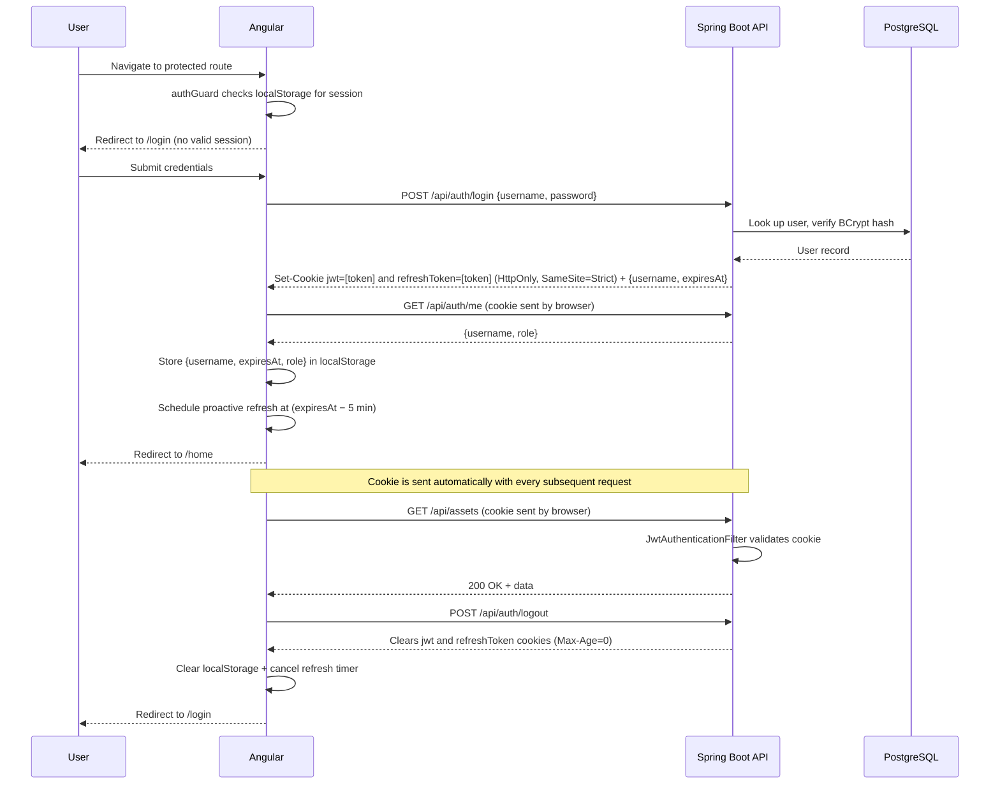

[← Back to README](../README.md)

# Security

Authentication and what the `security-reviewer` skill checks in this project.

## Authentication

The application uses **JWT stored in an HttpOnly cookie** (`SameSite=Strict`, `Path=/`), alongside a longer-lived `refreshToken` HttpOnly cookie (`SameSite=Strict`, `Path=/api/auth`, so the browser sends it only to the auth endpoints) used only to obtain a new JWT. All `/api/**` endpoints require the `jwt` cookie except the three under `/api/auth/` below (`SecurityConfig` also permits Swagger UI and `/v3/api-docs/**`, `/actuator/health` and `/actuator/prometheus` without it). Because the browser attaches cookies automatically to every same-origin request — including `` image loads and the native `EventSource` API — no custom `Authorization` header is needed and there is no risk of token theft via JavaScript.

## Public endpoints

| Method | Path | Description |
|---|---|---|
| `POST` | `/api/auth/login` | Authenticate; sets `jwt` + `refreshToken` HttpOnly cookies and returns `{ "username": "...", "expiresAt": "..." }` |
| `POST` | `/api/auth/refresh` | Reads the `refreshToken` cookie, rotates both cookies, and returns the same response shape as login |
| `POST` | `/api/auth/logout` | Clears both cookies server-side |

`GET /api/auth/me` also exists but is **not** public — it requires the `jwt` cookie and returns the current user's `{ "username": "...", "role": "..." }`.

## JWT flow



## Security configuration classes

| Class | Role |
|---|---|
| `config/SecurityConfig.java` | `SecurityFilterChain` bean; `@Profile("!test")` |
| `config/UserConfig.java` | `UserDetailsService` + `BCryptPasswordEncoder` beans; kept separate from `SecurityConfig` to avoid a circular dependency |
| `infrastructure/service/JwtAuthenticationFilter.java` | Reads the `jwt` cookie on every request |
| `infrastructure/service/JwtTokenServiceAdapter.java` | HMAC-SHA256 token generation/validation |
| `infrastructure/web/filter/RequestCorrelationFilter.java` | Registered at `Ordered.HIGHEST_PRECEDENCE`, ahead of the whole Spring Security chain; see [Request correlation & MDC logging](#request-correlation--mdc-logging) |

## SSE + Spring Security async dispatch

`SseEmitter` writes happen on a Tomcat async dispatch thread, not the
original request thread. Spring Security's filter chain re-runs on that
thread, where `SecurityContextHolder` is empty — without a fix, every SSE
write fails with `AuthorizationDeniedException` ("response is already
committed"). The fix is a rule that must come **first** in
`SecurityFilterChain`:

```java
.authorizeHttpRequests(auth -> auth
        .dispatcherTypeMatchers(DispatcherType.ASYNC).permitAll()   // must be first
        .requestMatchers("/api/auth/login", "/api/auth/logout", "/api/auth/refresh").permitAll()
        .requestMatchers("/api/admin/**").hasRole("ADMIN")
        .requestMatchers("/api/**").authenticated()
        .anyRequest().permitAll()
)
```

This affects every SSE endpoint: catalog, sync, convert, and upload
progress streams.

## Request correlation & MDC logging

`RequestCorrelationFilter` runs at `Ordered.HIGHEST_PRECEDENCE` — before
Spring Security's own filter chain (auto-configured order `-100`) — so a
`requestId` (UUID) and `username` are already in SLF4J MDC, and the
`X-Request-ID` response header already set, no matter how far the request
gets (including a `RateLimitFilter` short-circuit or a Security denial).
Because authentication hasn't happened yet at that point, `username` starts
as `"anonymous"`; once `JwtAuthenticationFilter` validates the `jwt` cookie
and establishes the `SecurityContext`, it overwrites the MDC `username`
entry in place with the real principal, so log lines from that point on in
the request are correlated to the authenticated user rather than
`"anonymous"`. MDC is cleared in a `finally` block once the filter chain
returns.

The `requestId` is echoed back as the `X-Request-ID` response header
(exposed to the browser via CORS `exposedHeaders` in `AppConfig`) so the
Angular `authInterceptor` can append `[Request ID: <id>]` to the error
snackbar it shows the user — giving them something to quote when reporting
an issue, which support can then grep for directly in the JSON log file
(`logstash-logback-encoder` includes both MDC fields in every log line).

## Configuration properties

| Property | Default | Description |
|---|---|---|
| `photomanager.jwt-secret` | *(empty — must be set)* | HS256 signing secret (≥ 32 bytes) |
| `photomanager.jwt-expiry-hours` | `24` | JWT access-token validity in hours |
| `photomanager.refresh-token-expiry-days` | `30` | Refresh-token validity in days |

## Generating JWT_SECRET

Generate a cryptographically random 32-byte base64 string using the command for your platform:

**Linux / macOS:**
```bash
openssl rand -base64 32
```

**Windows (PowerShell):**
```powershell
$bytes = New-Object byte[] 32
[System.Security.Cryptography.RandomNumberGenerator]::Create().GetBytes($bytes)
[Convert]::ToBase64String($bytes)
```

## Setup (local development)

1. Copy `src/main/resources/application-local.yml.example` to `src/main/resources/application-local.yml`
2. Generate a secure secret using the command for your platform (see [Generating JWT_SECRET](#generating-jwt_secret)) and paste the output into `photomanager.jwt-secret` in `application-local.yml`

> **Important:** The application **will not start** if `photomanager.jwt-secret` is blank. `application-local.yml` is git-ignored and must never be committed.

## Setup (Docker Compose)

Set `JWT_SECRET` in `JPPhotoManagerWeb/.env` using the command for your platform:

**Linux / macOS:**
```bash
echo "JWT_SECRET=$(openssl rand -base64 32)" >> JPPhotoManagerWeb/.env
```

**Windows (PowerShell):**
```powershell
$bytes = New-Object byte[] 32
[System.Security.Cryptography.RandomNumberGenerator]::Create().GetBytes($bytes)
$secret = [Convert]::ToBase64String($bytes)
Add-Content -Path JPPhotoManagerWeb\.env -Value "JWT_SECRET=$secret"
```

## Configuring multiple catalog root folders

The backend accepts a semicolon-separated list of root directories via the `photomanager.root-catalog-folders` property. Every directory in the list is scanned recursively when the catalog runs.

### Local development (`application-local.yml`)

Add or extend the `root-catalog-folders` key in `src/main/resources/application-local.yml`:

```yaml
photomanager:
  jwt-secret: "…"
  initial-directory: "C:/Users/yourname/Pictures"
  root-catalog-folders: "C:/Users/yourname/Pictures;C:/Users/yourname/OneDrive/ExtraFolder"
```

`initial-directory` controls which folder is shown first when the gallery loads; it can be any one of the roots (or any sub-folder).

### Docker Compose

Each additional directory must be:

1. Declared in `.env`:
   ```
   HOST_IMAGE_DIR=C:/Users/yourname/Pictures
   HOST_IMAGE_DIR_2=C:/Users/yourname/OneDrive/ExtraFolder
   ```

2. Added as a second bind mount in `docker-compose.yml` under the `backend` service:
   ```yaml
   volumes:
     - type: bind
       source: ${HOST_IMAGE_DIR}
       target: /catalog
     - type: bind
       source: ${HOST_IMAGE_DIR_2}
       target: /catalog2
   ```

3. Included in `CATALOG_DIR` (also in `docker-compose.yml`):
   ```yaml
   environment:
     CATALOG_DIR: /catalog;/catalog2
   ```

After editing both files, recreate the backend container and run the catalog:

```bash
docker compose up -d --force-recreate backend
```

Then click **Run Catalog** in the UI. Repeat steps 1–3 for any further directories (`HOST_IMAGE_DIR_3` → `/catalog3`, etc.).

### Cloud storage paths (Google Drive, OneDrive, etc.)

Docker bind mounts only work with real filesystem paths — they cannot reach cloud storage virtual filesystems, regardless of offline-availability settings.

**Google Drive for Desktop (Windows):** maps your Drive to a virtual drive letter (e.g. `G:\`) using the Windows Cloud Files API. Even when a folder is marked *Available offline* the files are cached locally but still served through this virtual layer. Docker Desktop on Windows runs inside a WSL2 Linux VM, which has no access to virtual drive letters — `G:\My Drive\Photos` is invisible from inside the container, so `/catalog3` will appear empty and no assets will be indexed.

**Google Drive via FUSE (Linux/macOS — rclone, google-drive-ocamlfuse, GNOME GVFS):** FUSE mounts live in the host mount namespace and are not propagated into Docker containers by default. The container again sees an empty directory.

In both cases the `CatalogFolderPartitioner` finds the mount point, sees no files, and silently produces no catalog entries — no error is surfaced.

**Workarounds:**

| Approach | Works on | Notes |
|---|---|---|
| Point to the Backup & Sync local folder (`C:\Users\yourname\Google Drive\…`) | Windows | Only the older *Google Backup and Sync* client stores files as plain NTFS files at an addressable path. Google Drive for Desktop does not. |
| `rclone sync gdrive:FolderName /local/mirror` on a schedule | All | Copy files to a real local path first, then set `HOST_IMAGE_DIR_N` to that path. Most reliable option for the current Google Drive for Desktop client. |
| `robocopy G:\My Drive\FolderName C:\local\mirror /MIR` on a schedule | Windows | Windows-native alternative to rclone. |

## Default admin user

On first startup, if no users exist in the database, the application automatically creates a default administrator:

| Username | Password |
|---|---|
| `admin` | `admin` |

**Change this password immediately** after first login using the **User Administration** page (`/admin/users`).

## User Administration

Navigate to **Users** in the navigation bar (or `/admin/users`) to:
- View all users
- Add new users
- Change a user's password
- Delete users

There is no self-registration; all user management is done by an authenticated administrator.

## Session Management

Navigate to **Sessions** in the navigation bar (or `/profile/sessions`) to view and manage your own active sessions — each refresh token issued to your account is one "session."

| Method | Path | Description |
|---|---|---|
| `GET` | `/api/auth/sessions` | List the caller's non-expired, non-revoked sessions: `id`, `deviceHint`, `lastUsedAt`, `current` |
| `DELETE` | `/api/auth/sessions/{id}` | Revoke one session by id; `404` if it doesn't belong to the caller |
| `DELETE` | `/api/auth/sessions` | Revoke every other active session ("sign out everywhere else"); requires the `refreshToken` cookie to identify which session to keep — `400` if that cookie is missing |

`deviceHint` is derived from the `User-Agent` header stored on the `refresh_tokens` row at token-issue time (e.g. `"Chrome on macOS"`, `"Mobile Safari"`) via a keyword heuristic (`DeviceHintParser`), not a full UA-parsing library. `lastUsedAt` is updated on every `/api/auth/refresh` call. The session matching the request's own `refreshToken` cookie value is marked `current: true` and its "Revoke" button is disabled in the UI — a session can only be ended remotely, not from itself, to avoid a confusing self-logout mid-list.

## Security review checks

What the `security-reviewer` skill checks in this project, on top of its generic checklist. The section numbers (§N) are the ones the review reports cite, so they stay stable.

### 1. Dependency Vulnerabilities

#### 1.1 Backend (Maven)

Run the OWASP dependency check and review the output:

```bash
cd JPPhotoManagerWeb/backend
mvn org.owasp:dependency-check-maven:check
```

Alternatively, audit with the Maven Versions plugin:

```bash
mvn versions:display-dependency-updates
```

🔴 Flag any dependency with a known CVE rated **CRITICAL** or **HIGH** in the
NVD database.

🟡 Flag any Spring Boot, Spring Security, or Flyway version that is more than
two minor versions behind the latest stable release — these libraries receive
frequent security patches.

🟡 Flag any transitive dependency that is being overridden with an older version
via `<dependencyManagement>` — verify the override is intentional.

#### 1.2 Frontend (npm)

```bash
cd JPPhotoManagerWeb/frontend
npm audit --audit-level=high
```

🔴 Flag any package with a `critical` or `high` severity audit finding that has
a fix available (`npm audit fix`).

🟡 Flag packages that are significantly outdated and have known security advisories
(check https://security.snyk.io or the npm advisory database).

🟢 Flag `devDependencies` with audit findings — lower risk but still worth
updating, since build tools can be exploited in CI.

### 2. File System Security (Critical for a Photo Manager)

The application reads, writes, and thumbnails arbitrary file paths supplied by
the user. This is the highest-risk attack surface in this codebase.

#### 2.1 Path Traversal

🔴 Flag any file operation that uses a user-supplied path directly without
canonicalisation and containment checks. The canonical fix is:

```java
Path base = Paths.get(allowedRootDirectory).toRealPath();
Path target = base.resolve(userSuppliedRelativePath).normalize();
if (!target.startsWith(base)) {
    throw new SecurityException("Path traversal attempt: " + target);
}
```

🔴 Flag any endpoint that returns file contents (bytes, streams) when the path is
derived from a request parameter without the check above.

🔴 Flag any thumbnail URL or file URL that embeds an absolute filesystem path
exposed in an API response — callers should receive an opaque ID, not a raw path.

#### 2.2 File Type Validation

🔴 Flag any file-upload or file-read path that relies **only** on the file
extension to determine content type. Magic-byte validation must also be done:

```java
// Apache Commons Imaging already does this for supported formats
// For a generic check, use Tika or Files.probeContentType()
String detectedType = tika.detect(inputStream);
if (!ALLOWED_MIME_TYPES.contains(detectedType)) {
    throw new IllegalArgumentException("Unsupported file type: " + detectedType);
}
```

🟡 Flag any code that writes a user-supplied filename directly to disk without
sanitising it (remove `..`, `/`, `\`, null bytes, and leading dots).

#### 2.3 Thumbnail Generation

🟡 Flag thumbnail generation code that does not set limits on image dimensions
before decoding. Decompression bomb (e.g., a 1×1 JPEG that expands to 100 MB)
can exhaust heap. Use a library that supports dimension-before-decode checks.

🟢 Flag any temporary file created during thumbnail generation that is not
cleaned up in a `finally` block or `try-with-resources`.

### 3. Sensitive Data Handling

#### 3.1 Logging

🔴 Flag any `log.info`, `log.debug`, or `log.error` call that includes:
- Passwords or password hashes
- JWT token values
- Full absolute file paths that contain the user's home directory (e.g.,
  `/home/alice/Pictures/private/...`) — log only relative paths or asset IDs.

🟡 Flag any exception that is caught and re-thrown with the original message
embedded in an API response — stack traces and internal paths must not reach
the client.

#### 3.2 API Error Responses

🔴 Flag any `@ExceptionHandler` or catch block that returns a stack trace,
Hibernate error message, or SQL snippet in the response body. Return a safe,
generic message instead:

```java
// Wrong
return ResponseEntity.status(500).body(e.getMessage()); // may expose schema

// Right
log.error("Unexpected error", e);
return ResponseEntity.status(500).body("An internal error occurred.");
```

🟡 Flag 404 responses that confirm the existence of resources the caller
should not know about (e.g., `"Asset 42 exists but you cannot see it"` vs
a plain 404).

#### 3.3 Hardcoded Secrets

🔴 Flag any hardcoded password, API key, secret key, or token in Java source,
`application.yml`, `application.properties`, or Angular environment files.
Secrets must come from environment variables or a secrets manager:

```yaml
# Wrong
spring.datasource.password: mysecretpassword

# Right
spring.datasource.password: ${POSTGRES_PASSWORD:postgres}
```

🔴 Flag any secret committed to `application-local.yml` that is **not** in
`.gitignore`.

🚫 **Never read `JPPhotoManagerWeb/k8s/secret.yaml` or
`JPPhotoManagerWeb/k8s/catalog-volumes.yaml`** while hunting for hardcoded
secrets — per `JPPhotoManagerWeb/CLAUDE.md`, both hold real secrets and
machine-specific paths and must never be read under any circumstances, not
even as part of a broad "review all the code" sweep. Both are gitignored by
design (that's the correct pattern, not a finding) and have `.example`
counterparts safe to read instead if you need to reason about their
structure. If a full-codebase sweep would otherwise walk `k8s/`, skip these
two files specifically rather than skipping the whole directory.

### 4. Authentication & JWT / Cookie Security

#### 4.1 HttpOnly Cookie (not Authorization header)

🔴 Flag any code that reads the JWT from a query parameter
(`?token=...`) or a custom header for `EventSource` or `` endpoints.
Tokens in URLs appear in server logs and browser history. The project uses
HttpOnly cookies — see `java-developer` skill §15.1 for the correct pattern.

🔴 Flag any `ResponseCookie` that is missing `.httpOnly(true)`, `.sameSite("Strict")`
or an explicit `.path(...)`. The path is deliberate per cookie: `/` for the JWT
cookie and `REFRESH_COOKIE_PATH` (`/api/auth`) for the refresh cookie, both in
`AuthCookieFactory`; flag a cookie whose path is wider than that.

🟡 Flag any `ResponseCookie` built without `.secure(true)` (or with
`secure: false`) when the app is deployed over HTTPS. `AuthCookieFactory`
currently never sets `Secure`: verify whether that is still true and whether
TLS terminates in front of the app.

#### 4.2 Spring Security Filter Chain

🔴 Flag any `SecurityFilterChain` that does not include
`.dispatcherTypeMatchers(DispatcherType.ASYNC).permitAll()` as the **first**
rule. Missing this causes `AuthorizationDeniedException` on `SseEmitter` async
dispatch threads (see `java-developer` skill §15.2).

🔴 Flag any endpoint that handles write operations (`POST`, `PUT`, `PATCH`,
`DELETE`) but is permitted without authentication.

🟡 Flag `http.csrf().disable()` without a comment explaining why — CSRF
protection should only be disabled when the API is stateless (JWT-based) and
does not use cookie-based session auth. If the project switches to HttpOnly
cookies, CSRF protection via `SameSite=Strict` must be verified.

🟡 Flag Spring Boot Actuator endpoints (`/actuator/**`) that are exposed
without authentication in production profiles.

Before doing the endpoint-by-endpoint cross-check above by hand, run
`bash scripts/auth-coverage-report.sh` from `backend/` — it parses
`SecurityConfig.java`'s ordered `requestMatchers` rules and every
`@RestController`'s mapping annotations, then writes a dated table under
`JPPhotoManagerWeb/docs/reports/auth-coverage/` showing exactly which rule
governs every endpoint (plus any method-level `@PreAuthorize`, a separate,
tighter restriction the table doesn't try to merge into the same column).
It is a factual snapshot, not a judgment call — an endpoint resolving only
to the `anyRequest` fallback isn't automatically wrong (the fallback
itself is `permitAll()`, and some endpoints are intentionally public), but
it's exactly the kind of gap this cross-check is meant to catch: a new
controller silently inheriting a broader rule than intended because
`SecurityConfig`'s ordered matcher list is easy to lose track of as
controllers are added. The regex-based path matching it uses is an
approximation of Spring's real `PathPattern` matcher, so treat a
surprising row as a prompt to go read `SecurityConfig.java` directly, not
as ground truth on its own.

#### 4.3 Password Storage

🔴 Flag any code that stores or compares passwords in plaintext.

🔴 Flag any use of MD5 or SHA-1 for password hashing. Use BCrypt with a work
factor ≥ 10:

```java
new BCryptPasswordEncoder(12)
```

🟡 Flag any `UserDetailsService` that loads users from a hardcoded in-memory
list in a non-test profile — production must load from the repository.

### 5. Injection Vulnerabilities

#### 5.1 SQL / JPQL Injection

🔴 Flag any `@Query` that concatenates user input into the JPQL or SQL string
instead of using named parameters:

```java
// Wrong
@Query("SELECT a FROM Asset a WHERE a.fileName = '" + fileName + "'")

// Right
@Query("SELECT a FROM Asset a WHERE a.fileName = :fileName")
List<Asset> findByFileName(@Param("fileName") String fileName);
```

🟡 Flag any `EntityManager.createNativeQuery()` call that uses string
concatenation with user input.

#### 5.2 OS Command Injection

🔴 Flag any call to `Runtime.exec()`, `ProcessBuilder`, or similar that
includes a user-supplied value without shell-escape:

```java
// Wrong — user supplies folderPath
Runtime.getRuntime().exec("ls " + folderPath);

// Right — pass as separate argument, never via shell string
new ProcessBuilder("ls", folderPath).start();
```

🔴 Flag any image-processing library invocation (e.g., ImageMagick via CLI
wrapper) that interpolates user-supplied filenames into a shell command.

### 6. Frontend Security

#### 6.1 Token & Sensitive Data in Storage

🔴 Flag any Angular code that stores the JWT token string in `localStorage`,
`sessionStorage`, or a cookie accessible to JavaScript. The token must live
only in an HttpOnly cookie managed by the backend. What may be stored in
`localStorage` is non-sensitive session metadata (username, expiry timestamp).

🔴 Flag any `localStorage.setItem` call whose value is derived from an API
response field named `token`, `accessToken`, `jwt`, or similar.

#### 6.2 XSS

🔴 Flag any use of `[innerHTML]` binding with user-supplied content that is not
explicitly sanitised through Angular's `DomSanitizer`.

🟡 Flag any Angular template that renders a user-controlled URL in an `href` or
`src` attribute without `sanitizer.bypassSecurityTrustUrl()` being justified
by a comment.

🟡 Flag any `bypassSecurityTrust*` call — each one requires a clear justification
comment explaining why sanitisation is safe to bypass.

#### 6.3 CORS & API Configuration

🟡 Flag `@CrossOrigin(origins = "*")` on controllers — wildcard origins are
acceptable in development but must be restricted to known frontend origins in
production via `AppConfig.corsFilter()`.

🟡 Flag the CORS allowed-methods list in `AppConfig` if it is missing any HTTP
method actually used by the API (e.g., `PATCH` missing when `@PatchMapping`
endpoints exist).

### 7. Known Project-Specific Security Pitfalls

| Pitfall | What to look for |
| ------- | ---------------- |
| Path traversal in `StorageServiceAdapter` | `folderPath` or `fileName` used in `Paths.get(...)` without containment check |
| Thumbnail URL leaks absolute path | API response includes raw filesystem path instead of opaque `/api/assets/{id}/thumbnail` |
| JWT in query param for SSE | `EventSource` URL contains `?token=...` — use HttpOnly cookie instead |
| BCrypt work factor too low | `new BCryptPasswordEncoder()` with default or factor < 10 |
| Actuator endpoints open | `/actuator/health`, `/actuator/env` accessible without auth in prod |
| Hardcoded DB password | `application.yml` with literal `postgres` password not overridden by env var |
| CSRF disabled without SameSite | `csrf().disable()` when using HttpOnly cookies — verify `SameSite=Strict` is set |
| Stack trace in 500 response | `e.getMessage()` or `e.toString()` returned directly in response body |
| Decompression bomb | Image decoded without dimension check before allocating pixel buffer |
| User-supplied filename on disk | `fileName` used directly in `Files.write(Paths.get(dir, fileName))` without sanitisation |

### Full-codebase sweep layers

| Layer key               | Report suffix            | Directory scope                                                                                                                                            | Primary checklist sections                                    |
| ------------------------ | ------------------------- | ------------------------------------------------------------------------------------------------------------------------------------------------------- | --------------------------------------------------------------- |
| Backend domain           | `backend-domain`          | `backend/.../domain/**`                                                                                                                                   | §3.3 (low surface — pure POJOs/interfaces, few findings expected) |
| Backend application      | `backend-application`     | `backend/.../application/usecase/**`, `application/exception/**`                                                                                          | §3.1, §3.2 (custom exceptions), §3.3, §4.3                      |
| Backend api               | `backend-api`              | `backend/.../infrastructure/web/**` (controllers, DTOs, exception handlers, filters)                                                                      | §2.1 (endpoints returning file contents), §3.2, §3.3, §4.1, §6.3 (`@CrossOrigin` on controllers) |
| Backend infrastructure   | `backend-infrastructure`  | `backend/.../infrastructure/persistence/**`, `infrastructure/service/**`, `infrastructure/kafka/**`, `infrastructure/batch/**`, `infrastructure/config/**`, `infrastructure/adapter/**` | §2 (full), §3.3, §4.2, §4.3 (encoder bean), §5.1, §5.2, §6.3 (`AppConfig`) |
| Frontend core             | `frontend-core`            | `frontend/src/app/core/**`                                                                                                                                | §6.1                                                             |
| Frontend features         | `frontend-features`        | `frontend/src/app/features/**`                                                                                                                            | §6.1, §6.2                                                       |
| Frontend shared           | `frontend-shared`          | `frontend/src/app/shared/**`                                                                                                                              | §6.2                                                             |
| Cross-cutting             | `cross-cutting`            | Both sub-projects; no single directory                                                                                                                    | §1 (dependency vulnerabilities — `pom.xml`/`package.json` are project-wide, not per-layer), §7, any finding whose root cause spans two layers at once (e.g. JWT-in-URL: a backend controller emitting the URL and a frontend `EventSource` consuming it) |

If only the backend (or only the frontend) is in scope, skip the layers that
don't apply — e.g. a "review the whole backend's security" request produces
4 reports (domain, application, api, infrastructure) plus a backend-scoped
cross-cutting report, not all 8.

#### Subagent reminders

Include in each subagent's prompt, where it applies to that layer:

   - **A reminder never to read `JPPhotoManagerWeb/k8s/secret.yaml` or
     `JPPhotoManagerWeb/k8s/catalog-volumes.yaml`** (relevant to the
     `backend-infrastructure` and `cross-cutting` subagents in particular,
     since they're the ones most likely to touch config/deployment files) —
     see §3.3.

[← Back to README](../README.md)
